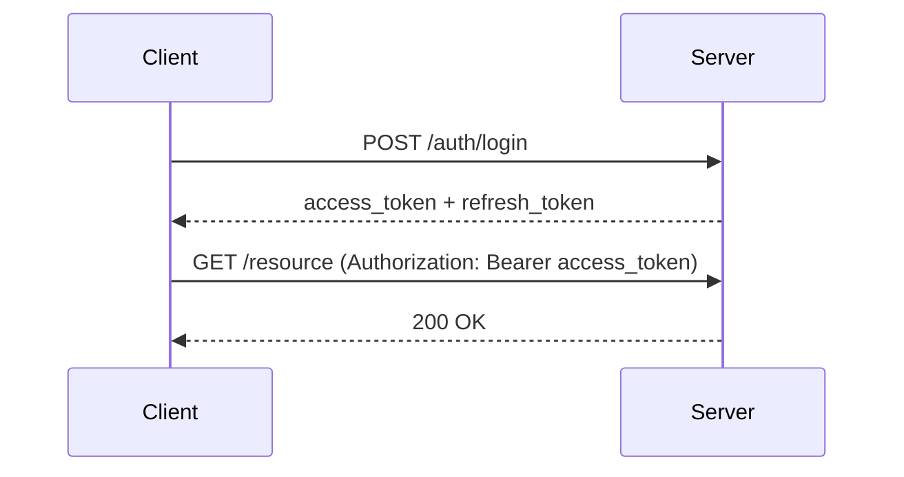

# Authentication Protocol Specification

## 1. Introduction

### 1.1 Purpose

This document specifies the ~~legacy~~ authentication protocol for the **Acme Identity Platform** version *3.0*. It replaces all previous versions.

### 1.2 Scope

The protocol covers:

- **Token issuance** and validation
- **Session management** with refresh tokens
- ~~Legacy HMAC support~~ (removed in v3.0)
- **OAuth 2.0** / **OIDC** compliance

### 1.3 Terminology

| Term | Definition |
|------|------------|
| `JWT` | JSON Web Token (RFC 7519) |
| `RS256` | RSA Signature with SHA-256 |
| `OIDC` | OpenID Connect protocol |
| `DPoP` | Demonstrating Proof of Possession |

## 2. Authentication Flow

### 2.1 Login Flow



The flow proceeds as follows:

1. Client sends credentials to `/api/v1/auth/login`
2. Server validates credentials and issues `JWT`
3. Client includes token in `Authorization` header
4. Server validates signature and expiry
5. If token is expired, client uses `refresh_token` to obtain a new one

### 2.2 Token Structure

```json
{
  "header": {"alg": "RS256", "typ": "JWT", "kid": "key-2025-01"},
  "payload": {
    "sub": "user_abc123",
    "iss": "https://auth.acme.example.com",
    "iat": 1718000000,
    "exp": 1718086400,
    "roles": ["admin", "editor"]
  }
}
```

### 2.3 Refresh Token Flow

```python
def refresh_access_token(refresh_token: str) -> dict:
    """Exchange a refresh token for a new access token."""
    # Step 1: Validate refresh token signature
    payload = verify_jwt(refresh_token)
    # Step 2: Check if refresh token is revoked
    if is_revoked(payload["jti"]):
        raise InvalidTokenError("Token revoked")
    # Step 3: Issue new access token
    new_token = create_access_token(payload["sub"])
    return {"access_token": new_token, "expires_in": 3600}
```

> **Warning:** Refresh tokens must be stored **securely**.
> Never expose them in client-side code or logs.

## 3. Security Considerations

### 3.1 Key Management

| Key | Algorithm | Rotation | Storage |
|-----|-----------|----------|---------|
| Signing | `RS256` | Every 90 days | HSM |
| Encryption | `AES-256-GCM` | Every 30 days | Vault |
| Session | `HMAC-SHA256` | Per request | Ephemeral |

### 3.2 Rate Limiting Rules

- **Login attempts**: 5 per minute per IP
- **Token refresh**: 10 per minute per client
- **API calls**: 1000 per hour per token

> **Note:** Rate limits are configurable per tenant.
> Contact your account manager to adjust limits.

### 3.3 Security Headers

All responses ~~must~~ **should** include:

- `Strict-Transport-Security: max-age=31536000`
- `X-Content-Type-Options: nosniff`
- ~~`X-Powered-By: Acme`~~ (deprecated, remove in production)
- `Cache-Control: no-store` (for auth endpoints)


## 4. Error Handling

### 4.1 Error Response Format

```json
{
  "error": "invalid_token",
  "error_description": "The access token has expired",
  "error_uri": "https://docs.acme.example.com/errors#invalid_token"
}
```

### 4.2 Error Codes

| Code | HTTP Status | Description |
|------|-------------|-------------|
| `invalid_request` | 400 | Missing or invalid parameters |
| `invalid_token` | 401 | Token expired or malformed |
| `insufficient_scope` | 403 | Missing required permissions |
| `rate_limit_exceeded` | 429 | Too many requests |

### 4.3 Recovery Strategies

1. ~~Retry immediately~~ (causes cascade failure)
2. **Exponential backoff** with jitter (recommended)
3. *Circuit breaker* pattern for persistent failures
4. Fallback to **cached credentials** when offline

## 5. Migration Guide

### 5.1 v2.x to v3.0

| Feature | v2.x | v3.0 |
|---------|------|------|
| Signing Algorithm | HMAC-SHA256 | RS256 |
| Token Format | Opaque | JWT |
| Refresh Token | Unlimited | 30-day rotation |
| Session Storage | In-memory | Redis cluster |
